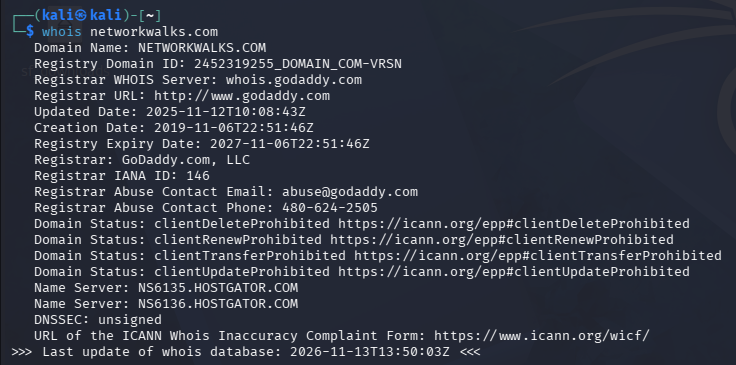
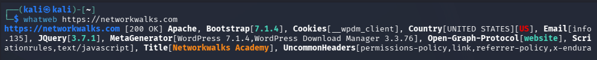
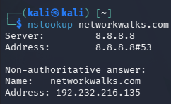
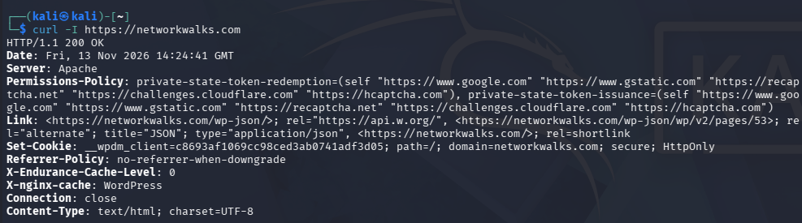
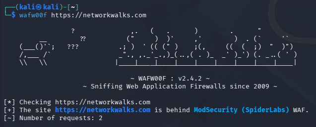
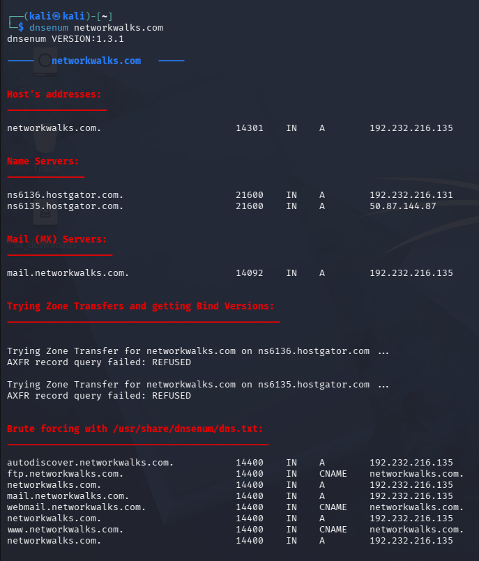
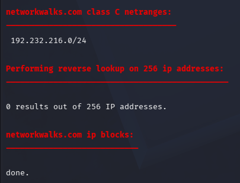
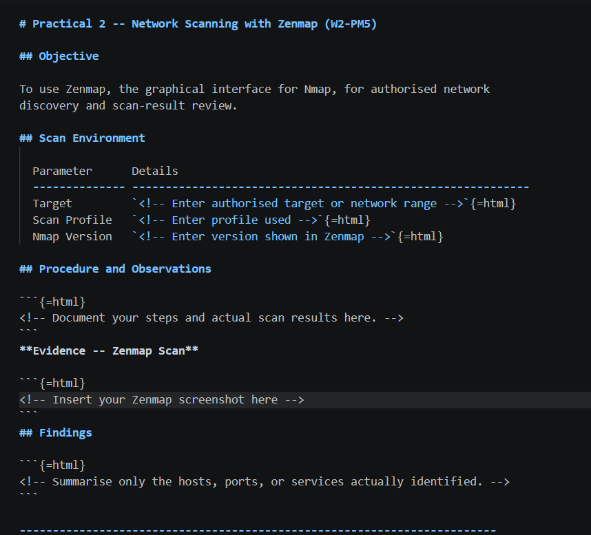
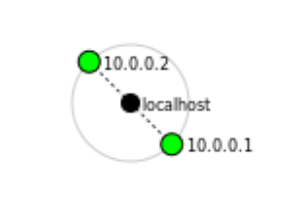

# Week 02 -- Reconnaissance and Network Scanning

**Cybersecurity Internship | NETWORKWALKS**

This repository documents my Week 02 practical work: footprinting the
assigned domain using Kali Linux tools and performing authorised network
discovery with Zenmap.

## Objectives

- Collect publicly available information about the assigned domain.
- Identify website technologies and inspect HTTP response information.
- Explore DNS records and domain infrastructure.
- Check for detectable Web Application Firewall protection.
- Practise authorised network discovery with Zenmap.
- Document methodology, observations, and evidence.

## Lab Environment

| Parameter | Details |
|---|---|
| Operating System | Kali Linux (VirtualBox VM) |
| Host OS | Windows |
| Virtualization | Oracle VirtualBox |
| Footprinting Tools | WHOIS, WhatWeb, Nslookup, cURL, Wafw00f, DNSenum |
| Network Scanner | Zenmap / Nmap |
| Target Domain | `networkwalks.com` |
| Network Interface | `eth0` |
| Kali IPv4 | `10.0.0.2/24` |
| NAT Network | `NATNetwork` |
| Subnet | `10.0.0.0/24` |
| Gateway | `10.0.0.1` |

## Authorisation and Scope

Footprinting is focused on the internship-assigned domain
`networkwalks.com` and publicly available information. Network scanning
is limited to an authorised lab or network scope. No exploitation or
unauthorised access is performed.

---

# Practical 1 -- Footprinting and Reconnaissance (W2-PM1)

## Objective

To collect publicly available domain and website information using six
Kali Linux tools.

## Tools Used

1. WHOIS
2. WhatWeb
3. Nslookup
4. cURL
5. Wafw00f
6. DNSenum

## 1. WHOIS -- Domain Registration Lookup

WHOIS retrieves domain registration information, including registrar
details, registration dates, domain status, and nameservers.

**Command:**

```bash
whois networkwalks.com
```

**Observations:**
- Registrar listed: GoDaddy.com, LLC
- Creation date: 6 November 2019
- Registry expiry date: 6 November 2027
- Nameservers: `NS6135.HOSTGATOR.COM` and `NS6136.HOSTGATOR.COM`
- DNSSEC status: unsigned
- The output included client-level domain status restrictions.
- The response returned registration details, followed by a rate-limit notice.

**Security Relevance:** Domain registration data provides context about
domain registration and DNS infrastructure during reconnaissance.

**Evidence -- WHOIS Result**



## 2. WhatWeb -- Website Technology Identification

WhatWeb identifies technologies and software signatures that are
publicly detectable on a website.

**Command:**

```bash
whatweb https://networkwalks.com
```

**Observations:**
- The website responded with HTTP status `200 OK`.
- The web server was identified as Apache.
- WhatWeb detected Bootstrap version `7.1.4` and jQuery version `3.7.1`.
- WordPress was identified as the website's content management system.
- WordPress Download Manager version `3.3.76` was detected.
- The website title was identified as `NetworkWalks Academy`.
- The detected country was the United States.

**Security Relevance:** Technology identification helps document the
publicly visible web stack and provide context for a security
assessment.

**Evidence -- WhatWeb Result**



## 3. Nslookup -- DNS Lookup

Nslookup queries DNS to retrieve information such as the IP address
associated with a domain.

**Command:**

```bash
nslookup networkwalks.com
```

**Observations:**
- The DNS query was performed using Google DNS (`8.8.8.8`).
- The response was marked as a non-authoritative answer.
- The domain `networkwalks.com` resolved to IPv4 address `192.232.216.135`.

**Security Relevance:** DNS lookup provides a basic view of domain
resolution and the DNS infrastructure responding to the query.

**Evidence -- Nslookup Result**



## 4. cURL -- HTTP Response Header Inspection

cURL requests HTTP response headers to review server responses and
publicly returned header information.

**Command:**

```bash
curl -I https://networkwalks.com
```

**Observations:**
- The server returned HTTP status `200 OK`.
- The server was identified as Apache.
- The response included `Content-Type: text/html; charset=UTF-8`.
- The `X-Nginx-cache` header indicated `WordPress`.
- The response included a `Permissions-Policy` header.
- A `Set-Cookie` header was present with the `HttpOnly` and `Secure` attributes.

**Security Relevance:** Response-header inspection documents visible
web-server behaviour and configuration information.

**Evidence -- cURL Result**



## 5. Wafw00f -- Web Application Firewall Detection

Wafw00f checks whether a website appears to be protected by a Web
Application Firewall (WAF).

**Command:**

```bash
wafw00f https://networkwalks.com
```

**Observations:**
- Wafw00f detected a Web Application Firewall protecting `https://networkwalks.com`.
- The identified WAF was `ModSecurity (SpiderLabs)`.
- The detection process completed after sending 2 requests.

**Security Relevance:** WAF detection may indicate web application
protection mechanisms exposed to external requests. Detection alone does
not provide a complete security assessment.

**Evidence -- Wafw00f Result**



## 6. DNSenum -- DNS Enumeration

DNSenum gathers DNS-related information for a domain, such as records
and nameserver details.

**Command:**

```bash
dnsenum networkwalks.com
```

**Observations:**
- The domain resolved to IPv4 address `192.232.216.135`.
- The nameservers identified were `ns6135.hostgator.com` and `ns6136.hostgator.com`.
- The nameserver IP addresses were identified as `50.87.144.87` and `192.232.216.131`.
- The domain's DNS IP block was identified as `192.232.216.0/24`.
- Reverse lookup returned 0 results out of 256 IP addresses.
- DNSenum identified subdomains including `autodiscover.networkwalks.com`, `ftp.networkwalks.com`, `mail.networkwalks.com`, and `webmail.networkwalks.com`.
- Zone transfer attempts against both nameservers were refused.

**Security Relevance:** DNS enumeration helps map publicly exposed
domain infrastructure and understand DNS records associated with a
target.

**Evidence -- DNSenum Result**




---

# Practical 2 -- Network Scanning with Zenmap (W2-PM5)

## Objective

To use Zenmap, the graphical interface for Nmap, for authorised network
discovery and scan-result review.

## Scan Environment

| Parameter | Details |
|---|---|
| Target | `10.0.0.0/24` |
| Scan Profile | Ping scan |
| Nmap Version | 7.99 |

## Procedure and Observations

The Zenmap graphical interface was used to perform host discovery on the
authorised VirtualBox NAT Network.

The target network was configured as `10.0.0.0/24`, and the Ping Scan
profile was selected. The scan was initiated to identify active hosts
within the network.

**Observations:**
- The scan covered 256 IP addresses.
- Two hosts were identified as active.
- Host `10.0.0.1` was identified as the network gateway.
- Host `10.0.0.2` was identified as the Kali Linux VM.
- The scan completed in approximately 7 seconds.

**Evidence -- Zenmap Scan**



**Evidence -- Zenmap Network Topology**



## Findings

- Two active hosts were discovered within the scanned subnet.
- The identified hosts were `10.0.0.1` and `10.0.0.2`.
- The network topology graphic displayed the localhost node and the two discovered hosts.
- No port or service enumeration was performed as part of this Ping Scan.

The results provide a basic overview of the active devices in the
authorised lab network.

---

# Summary of Findings

| Tool / Practical | Purpose | Result |
|---|---|---|
| WHOIS | Domain registration lookup | Registration details retrieved |
| WhatWeb | Website technology identification | Apache, WordPress, Bootstrap, and jQuery detected |
| Nslookup | DNS lookup | Domain resolved to `192.232.216.135` |
| cURL | HTTP response headers | HTTP `200 OK`; Apache server and response headers inspected |
| Wafw00f | WAF detection | ModSecurity (SpiderLabs) detected |
| DNSenum | DNS enumeration | DNS records, nameservers, IP block, and subdomains identified |
| Zenmap | Authorised network discovery | Two active hosts discovered in `10.0.0.0/24` |

# Key Learning Outcomes

- Practised domain reconnaissance with multiple Kali Linux tools.
- Reviewed domain registration and nameserver information.
- Explored website technology, DNS, HTTP headers, and WAF detection.
- Applied network scanning concepts through Zenmap within an authorised scope.
- Documented practical methodology and evidence.

# Conclusion

Week 02 provided practical exposure to reconnaissance and network
discovery. The exercises used publicly available domain information and
authorised lab scanning to build familiarity with Kali Linux tools and
their outputs.

---

## Project Details

| Field | Details |
|---|---|
| Internship | NETWORKWALKS Cybersecurity Internship |
| Week | 02 |
| Elective | W2-PM1 -- Footprinting with Multiple Kali Tools |
| Essential | W2-PM5 -- Zenmap-Based Network Scanning |
| Target Domain | `networkwalks.com` |
| Author | Aditya Nambiar |
